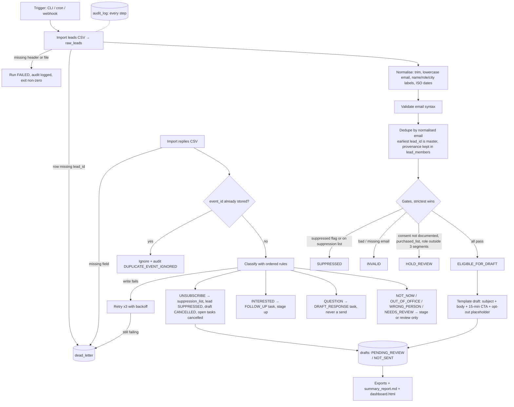

# Cashback Property - Technical Automation PoC

A coded (Python 3 + SQLite, standard library only) workflow that imports the sample leads, cleans / dedupes / gates them, queues review-only email drafts, triages simulated replies, and records everything in a CRM-style tracker with an audit log.

**Nothing is ever sent.** There is no SMTP/LinkedIn/API client in the code, and the database itself refuses a draft that is not `send_state = 'NOT_SENT'`. Sample data only.

## Run it

```bash
python3 pipeline.py run          # full end-to-end run; safe to repeat
python3 tests/test_acceptance.py # 21 checks (assignment tests + failure recovery)
bash demo.sh                     # guided demo for the screen recording
python3 pipeline.py reset        # wipe tracker + exports
```
No installs needed (Python 3.9+). Outputs land in `output/`.

## Why coded instead of n8n
The orchestration is explicit, testable code: one transaction per event, ordered gates, a retry wrapper, a dead-letter table, and a test suite that proves the rerun and failure behaviour. Trade-off: no visual canvas; the diagram below replaces it.

## Workflow



**Trigger mechanism:** `python3 pipeline.py run` by hand, or cron (`*/15 * * * * cd /path/cashback-poc && python3 pipeline.py run`), or the optional webhook (`webhook_server.py`). Every path is idempotent, so overlapping or repeated triggers are harmless.

**Error branch:** any unhandled exception marks the run `FAILED` in `runs`, writes `RUN_FAILED` to the audit log, keeps all committed data, and exits with code 2. Transient write errors retry 3 times (0.2s / 0.4s) and then park the row in `dead_letter` while the rest of the batch continues.

## Data store choice: SQLite
One file, transactions (an event and all its side effects commit together or not at all), `UNIQUE` / `PRIMARY KEY` constraints that make idempotency structural rather than hoped-for, and a `CHECK` constraint that makes sending impossible. Google Sheets would need API credentials and has no transactions. Tables: `raw_leads`, `leads`, `lead_members`, `lead_stage`, `suppression_list`, `drafts`, `events`, `tasks`, `dead_letter`, `audit_log`, `runs`. Each is exported to CSV in `output/`.

## Field mappings
| Input (`leads` CSV) | Output (`leads` table) | Rule |
|---|---|---|
| lead_id, source, source_date | lead_id, source, source_date | Kept. Date converted `DD-MM-YYYY` -> ISO; original stays in `raw_leads`. Master = earliest lead_id in the group. |
| email | email_norm, email_valid, dedupe_key | trim + lowercase; regex syntax check. Only valid emails are dedupe keys, so two bad emails never merge. |
| first_name, last_name | same | trim, collapse spaces, capitalise. |
| company, city | company, city_norm | trim; city title-cased (`SYDNEY`, `brisbane ` -> `Sydney`, `Brisbane`). |
| role | role_norm, segment | `mortgage broker` / `Accountant` / `financial planner` (any case) -> segment. Anything else is held. |
| consent_status, suppressed | status, status_reasons | see gates below. |
| replies: event_id, lead_id, reply_text | `events`, `tasks` | event_id is the primary key; reply lead_id resolves to the merged master lead. |

**Status precedence (strictest across all merged rows wins):** SUPPRESSED > INVALID > HOLD_REVIEW > ELIGIBLE_FOR_DRAFT. `status_reasons` names the row and reason (e.g. `L003:CONSENT_UNKNOWN; L003:PURCHASED_LIST`).

## Reply rules (deterministic, ordered, first match wins)
UNSUBSCRIBE -> OUT_OF_OFFICE -> WRONG_PERSON -> NOT_NOW -> INTERESTED -> QUESTION -> NEEDS_REVIEW (see `RULES` in `pipeline.py`). No API key is needed. In production I would use an LLM for ambiguous replies and keep these rules as a safety floor, with UNSUBSCRIBE always checked by rules first.

## Acceptance tests (all pass: `python3 tests/test_acceptance.py`)
| # | Requirement | Result |
|---|---|---|
| 1 | L002 merges with L001 | L001 = L001+L002+L036, one lead |
| 2 | L005 blocked, also after rerun | SUPPRESSED, no draft, unchanged on rerun |
| 3 | L003, L011 held | HOLD_REVIEW (consent unknown + purchased list) |
| 4 | L007 invalid | INVALID (malformed email) |
| 5 | E002 suppresses L004; repeat import doesn't reverse | persistent `suppression_list`; merged duplicate L049 also blocked; draft cancelled |
| 6 | E005 repeated -> one event, one task | 1 event, 1 task |
| 7 | Nothing sent | 0 sent; DB rejects `send_state='SENT'` |

Failure demonstrations (also in the test suite): crash after E012 then recovery (12 events kept, rerun completes with 24 events / 9 tasks, no duplicates); flaky destination retried twice then succeeds; permanently failing destination parks the event in `dead_letter`, a later clean run picks it up; rows with missing fields go to `dead_letter`.

## Results (full run on the sample data)
Raw lead rows 90 | unique leads 84 (6 merged away) | SUPPRESSED 10 | HOLD_REVIEW 43 | INVALID 9 | draft-ready 22 (24 drafted, 2 cancelled after unsubscribe replies E002 and E009) | reply events 24 unique | open tasks 9 (5 FOLLOW_UP, 4 DRAFT_RESPONSE) | emails sent 0. Full numbers: `output/summary_report.md`; visual: `output/dashboard.html`.

## Assumptions and judgement calls (be ready to explain these)
- **Replies file:** named "25" but contains 26 data rows (24 unique events; E005 and E022 each appear twice).
- **`Broker`** is ambiguous (mortgage vs real-estate), so it is held for review rather than guessed. Blank roles, Solicitor, Buyer Agent and Real Estate Agent are also held.
- **Role is judged on the master row only**, so a blank role on a duplicate (L036) does not hold an otherwise good lead.
- **Merged rows are judged together:** if any row in a group is suppressed or purchased/unknown consent, the whole lead is blocked (L057 merges into suppressed L056).
- **`public_listing` with documented consent** is allowed through the gate because the brief only names purchased/unknown/review-required; production should reconsider this.
- **"No thanks" / "Not interested at this stage"** -> NOT_NOW (no task, no auto follow-up). "I need to check with my colleague" -> NEEDS_REVIEW.
- **E024 "Remove my contact details"** is treated as UNSUBSCRIBE and also logged as `PRIVACY_FLAG`, because it may be a data-removal request.
- **Tasks for held leads:** E016 (L040) and E022 (L073) are interested replies from HOLD_REVIEW leads. A follow-up task is created (a human decides; nothing is sent), but they are never draft-eligible. Tasks are blocked for suppressed leads.
- **Draft wording** makes no claims about commission rates, returns or familiarity; programme specifics are left for the reviewer. Placeholders: `{{SENDER_NAME}}`, `{{SENDER_BUSINESS_DETAILS}}`, `{{OPT_OUT_LINK}}`.

## Optional stretch: mock webhook
`WEBHOOK_SECRET=test-secret python3 webhook_server.py` then POST to `http://127.0.0.1:8099/events` with header `X-Signature: sha256=<HMAC-SHA256 of body>`. Tested: valid reply -> `accepted` (task created); same event again -> `duplicate` (no second task); bad signature -> HTTP 401 and `WEBHOOK_REJECTED` in the audit log; new lead -> normalised and gated (`ELIGIBLE_FOR_DRAFT`). Localhost only.

## Configuration placeholders
| Setting | Where | Default |
|---|---|---|
| `CASHBACK_OUT` | env | `./output` |
| `WEBHOOK_SECRET` | env (required for webhook) | none; test value only |
| `WEBHOOK_PORT` | env | `8099` |
| `--leads`, `--replies` | CLI | files in `data/` |
| `--inject crash_after:E012` / `flaky_destination:E010:2` | CLI | off (failure demos) |

## What would change for production
- **Credentials and secrets:** a secrets manager, per-environment keys, least-privilege service accounts; never in code or CSVs. Rotate the webhook secret.
- **API limits:** batch writes, respect each provider's rate limits (CRM, email, LLM), exponential backoff with jitter, a queue for bursts.
- **Australian marketing compliance (confirm with counsel):** the Spam Act 2003 (consent, accurate sender identification, a working unsubscribe honoured promptly) and the Privacy Act 1988 / Australian Privacy Principles for the data itself. A `consent_status` field in a CSV is not legal approval; production needs the actual consent record, its source and date, and a defined handling path for purchased lists (not used for marketing here).
- **Access controls:** role-based access to the tracker; the suppression list write-protected apart from the system and a privacy officer; audit log append-only and tamper-evident.
- **Human approval:** keep the review queue; add approver identity, timestamps and edit history; send only from an approved state, via a separate, reviewed sender service.
- **Data layer:** Postgres or a CRM instead of a local SQLite file, backups, retention and deletion policy (including honouring data-removal requests).
- **Operations:** monitoring and alerting on `FAILED` runs and dead-letter growth, structured logs, CI running the acceptance tests.

## AI assistance disclosure
Built with the help of an AI coding assistant (Claude, by Anthropic). I (the candidate) must be able to explain and modify every part live: the gate precedence, the idempotency keys (`events.event_id`, `tasks UNIQUE(event_id, task_type)`), the per-event transaction, and the retry / dead-letter path. **Edit this section so it states exactly what you used and what you changed yourself.**
